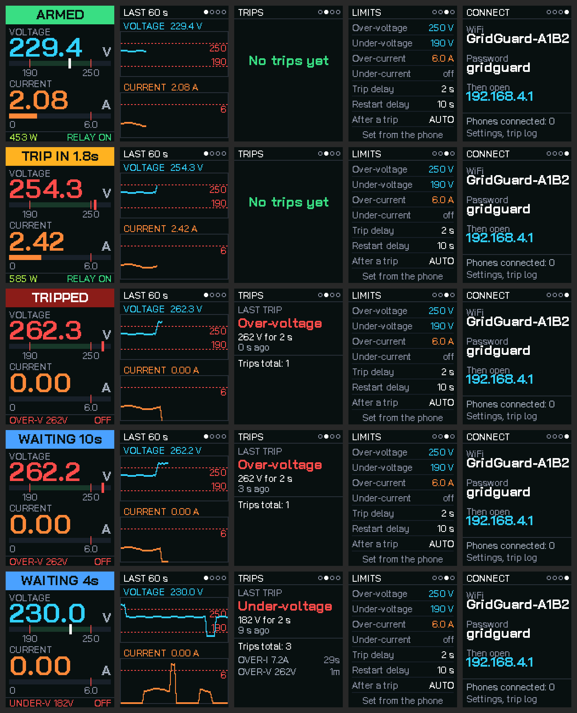
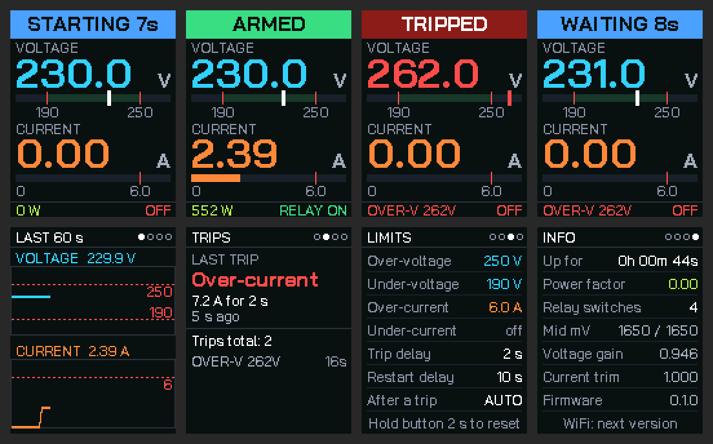
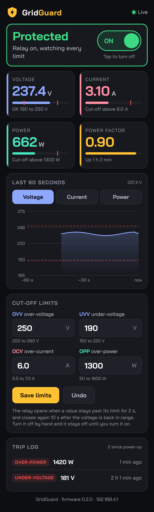

# GridGuard

An ESP32 protector for single-phase 230 V loads up to 6 A, built into a modular wall-plate box. It measures voltage and current and opens a relay on the live wire when they go outside the limits you set, then reconnects after a delay. Sister project of [PowerScope](https://github.com/shree-surya/PowerScope), which measures only; the sensing core (ZMPT101B + ACS712-20A into an ESP32) is the same.

| | |
|---|---|
| Protects against | over-voltage (OVV), under-voltage (UVV), over-current (OCV), over-power (OPP) |
| Display | 1.77" colour TFT (ST7735S, 128 x 160, SPI) |
| Web | own WiFi hotspot "GridGuard" (password `gridguard`), http://192.168.4.1: live readings, 60 s graph, limits, relay ON/OFF, trip log |
| Status | firmware 0.2.0: protection, display, button, WiFi and web page working in the PC simulation and a headless browser, not yet on hardware |



## Layout

```
firmware/GridGuard/                the firmware: sensors, protection, relay, buzzer, button, display, WiFi + web
web/index.html                     the web page (self-contained); tools/embed_web.py turns it into firmware/GridGuard/web_index.h
firmware/GridGuard_display_test/   display test: the five screens with simulated readings, no sensors
firmware/GridGuard_hw_test/        hardware test: sensors, button, buzzer, relay, LEDs on one screen
docs/GridGuard-spec.md             limits, states, pins, display and web plan
docs/wiring.md                     complete wiring: pins, dividers, relay, buzzer, button, TFT, power, mains
docs/GridGuard-project-page.html   project page with a working simulator of the trip logic
tools/ttf2gfx.py                   turns a TTF into an Adafruit GFX font (used for Bai Jamjuree)
tools/embed_web.py                 gzips web/index.html into web_index.h; run it after every edit of the page
```

## Flash the firmware

1. Arduino IDE, board **ESP32 Dev Module**, **Tools > Partition Scheme > Huge APP (3MB No OTA/1MB SPIFFS)**. Library Manager: **Adafruit GFX Library** and **Adafruit ST7735 and ST7789 Library**. From GitHub (Code > Download ZIP, then Sketch > Include Library > Add .ZIP Library): **ESP32Async/ESPAsyncWebServer** and **ESP32Async/AsyncTCP**.
2. Open `firmware/GridGuard/GridGuard.ino` (keep `BaiJamjuree.h` and `web_index.h` beside it) and upload.
3. Phone: join WiFi **GridGuard**, password **gridguard**, open **http://192.168.4.1**. Set OVV, UVV, OCV and OPP there and press Save limits (kept in flash). The ON/OFF switch turns the relay on or off; protection stays active while it is on.
4. Button: short press changes the screen, hold 2 s turns the relay on (also resets a trip; refused while the voltage is out of range) or off. The relay closes 10 s after power-up if the voltage is in range. A relay turned off by hand stays off until turned on again.
5. Calibrate in the Serial Monitor (115200, line ending "Newline"): `V 231.5` with your multimeter reading, `I 4.20` with your clamp meter reading on a kettle, `Z` with nothing plugged in, `F` if power reads negative, `?` to print.





## Run the display test

1. Arduino IDE, board **ESP32 Dev Module**. Library Manager: **Adafruit GFX Library** and **Adafruit ST7735 and ST7789 Library**.
2. Open `firmware/GridGuard_display_test/GridGuard_display_test.ino`. `BaiJamjuree.h` must stay in the same folder (it shows as a second tab).
3. Wiring: TFT VCC 3V3, GND, CS 5, RST 4, DC 27, SDA 19, SCK 23, BLK 3V3.
4. Upload. The screen changes every 5 s while a 100 s story runs: normal, over-voltage trip, reconnect, over-current trip, under-voltage trip. Serial Monitor at 115200 logs each trip.

If the picture is shifted, inverted or red and blue are swapped, see the notes at the top of the sketch.

## Licences

`BaiJamjuree.h` is generated from Bai Jamjuree (SIL Open Font License 1.1, Cadson Demak). No licence has been chosen for the rest of the repo yet.

## Safety

This switches 230 V mains. Relay on the live wire only, normally open, MCB stays as the real protection, every module inside a closed box. It is a learning and demonstration project, not a certified protection device.
